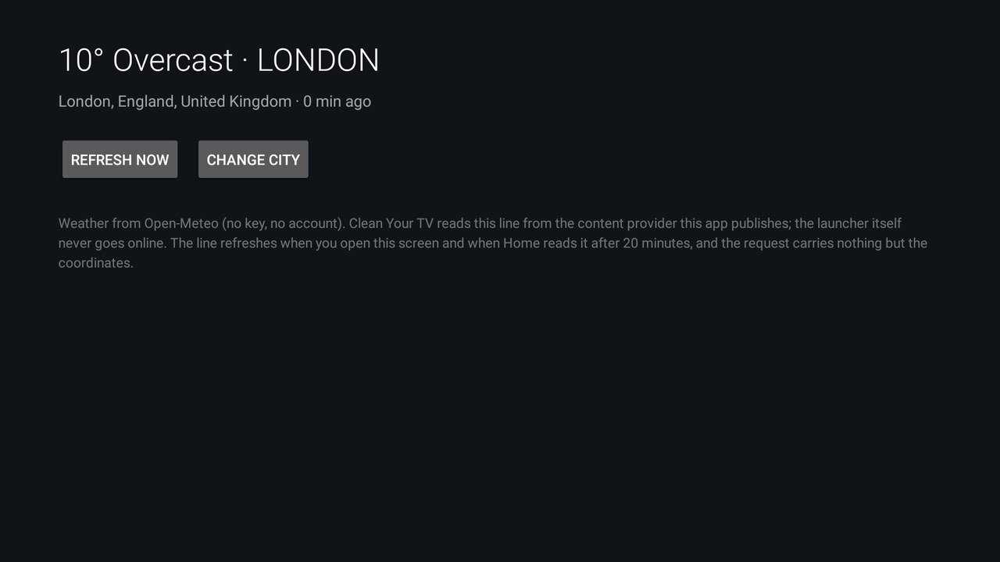

# Weather Glance

The weather for one city as a **single line under Clean Your TV's clock** — the sky glyph, the temperature and
the city, say `☁ 14° Takizawa` — instead of a tile, a pop-up or a page you have to open. The line sits with
the time, where you already look.

The add-on fetches from Open-Meteo (no key, no account); the launcher only reads what this app publishes
through its content provider, so Home itself still never goes online. It publishes the six columns the
launcher's `weather_now` contract names — `place`, `temperature`, `unit`, `code`, `is_day`, `updated_ms` —
and four more that are optional by design: the sky in words, the humidity, and a chance of precipitation and
of snow. The launcher draws the glyph and the line in its own style, and drops whichever optional part a
reading does not carry. The shape is the same as the Game Day
add-on's.

## Set it up

1. Install the APK (below) and open **Weather Glance** from the app grid.
2. Search for your city and pick it from the list. The screen shows the reading the add-on publishes, in
   its own wording ("10° Overcast · TAKIZAWA" — this screen upper-cases the place); Home draws its own
   line from the same columns, so it reads "☁ 10° Takizawa" — the sky symbol, its own degree, and the
   place in the case the add-on sent, which for this add-on is plain title case.
3. Tell the launcher to read it: put the package in the `weather_now` key, in `config.xml` or in a theme's
   `config.json`:

   ```json
   { "weather_now": "io.github.lostininaka.weatherglance" }
   ```

   Push the theme as usual (`tools/theme.sh <theme folder>`). Empty, uninstalled or a package that publishes
   nothing means no line at all — nothing to clean up.

The reading refreshes while the app's own screen is open, whenever Home asks for one that is more than 20
minutes old, and on a clock of its own every 20 minutes (`RefreshJob`, a `JobScheduler` job) whether or not
Home is on screen. That third one is what keeps the line honest: Home queries only while it is drawn, so a
set left inside another app for a day used to come back to a reading from the last time Home was visible —
and the launcher hides a reading older than three hours rather than print yesterday's weather. Home's query
is still answered from the cache first, and the app notifies it when a newer reading lands, so a slow network
never holds up Home's first frame.

## What it publishes

One row at `content://io.github.lostininaka.weatherglance.now/now`, the columns the `weather_now` contract
names, read by name:

| Column | Value |
|---|---|
| `place` | the city alone, without its region and country, so the line stays short |
| `temperature` | whole degrees Celsius, rounded |
| `unit` | `C` |
| `code` | Open-Meteo's WMO weather code, so the launcher picks the glyph |
| `is_day` | `1` when the sun is up at the city, `0` at night |
| `updated_ms` | when the reading was fetched |
| `sky` | the sky in words, e.g. `Overcast`, so the line can read the weather as well as draw it |
| `humidity` | relative humidity in percent, drawn as `Humidity 57%` |
| `precipitation_chance` | chance of precipitation in percent, from Open-Meteo's `precipitation_probability` |
| `snow_chance` | the same figure, but only when the forecast says snow — `null` otherwise |

The last four are optional in the contract: a reading that has no humidity, or a sky with no snow in it,
sends `null` there and the launcher leaves that part out. `snow_chance` is conservative on purpose —
Open-Meteo publishes no probability of snow, so the add-on only claims one when the current reading's code
is a snow code or its snowfall is above zero.

No row at all until a city is picked and fetched, and an answer fetched for a city the owner has since
changed is thrown away rather than stored — not even with a fresh timestamp.

## What Home draws

- One line, about 30 characters before the date column gets crowded: `☁ 14° Takizawa`.
- The glyph from the WMO `code` and `is_day` (`☀ ☁ ☂ ❄ ⚡`, a moon for a clear night). Text glyphs, not
  emoji: a TV's system font may have no colour emoji, and a tofu box under the clock is worse than no line.
  Each one carries U+FE0E, the text presentation selector, because `☀ ☔ ⚡ ❄` are emoji by default on a panel
  that ships NotoColorEmoji — without it, a cartoon umbrella turns up beside a plain line of type.
- The optional parts, in this order: `☀ 14° Takizawa · Mostly clear · Humidity 57% · Rain 60%` — the facts
  first, the forecast last. A chance of rain or snow appears only from 30% upward, because 20% under a clock
  is noise, and when the sky already says "Snow" or "Rain" the word is not repeated: `❄ 1° Takizawa · Snow · 70%`. It decides
  that from the WMO `code` as well as the word, because an add-on such as javierfn's writes the sky in the
  TV's own language: a Spanish provider saying "Nieve" costs the line no second label.
- No line at all until a city is picked, when the network is down and nothing was ever fetched, when the
  reading is more than three hours old, or when Home's `weather_now` names something else.

## Permissions

| Permission | Why |
|---|---|
| `INTERNET` | Open-Meteo: the place search and the current conditions. Nothing else leaves the TV, and the request carries nothing but the coordinates of the city you picked. |

The content provider is exported without a permission because the launcher has none to offer; it answers with
a city, a temperature, a weather code and the time it was fetched, and refuses every write. It holds nothing
private.

## Build and install

From the repository root, with JDK 17 and Android SDK 34 as for the launcher:

```bash
cd addons/weather-glance && ./gradlew assembleRelease && cd ../..
TV_HOST=<tv ip> tools/venv/bin/python -I tools/tv.py --push addons/weather-glance/app/build/outputs/apk/release/app-release.apk /data/local/tmp/addon.apk
TV_HOST=<tv ip> tools/venv/bin/python -I tools/tv.py 'pm install -r /data/local/tmp/addon.apk; rm -f /data/local/tmp/addon.apk'
```

Unit tests (the weather-code wording, the line's shape, and which reading is stored when the owner picks
another city mid-fetch) run without a TV:

```bash
cd addons/weather-glance && ./gradlew testReleaseUnitTest
```

## Tested on

Sharp AQUOS 4T-C70CN1 (`AQUOS-TVJ19`), Android TV 10 (SDK 29), 1920×1080, with Clean Your TV as Home.

## Screenshot



Its card shows as **Weather Glance** once the launcher asks; the card is only the way into this screen.

## Maintainer

[@LostInInaka](https://github.com/LostInInaka).
